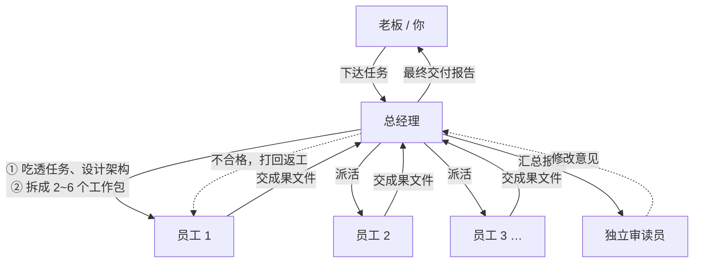

# 总经理工作模式（Agent Skill）

> 你只当老板：下一句任务，AI 总经理替你拆解分工、派活、验收返工、独立把关、汇总交付。

这是一个**平台无关的 Agent Skill**（一份 `SKILL.md` + 两份按需参考文档），把原来只能在 ZCode 里跑的「AI 总经理团队」多智能体工作流，重写成任何支持 Skill / 子 Agent 的 AI 编程助手都能加载的工作说明书。

- **不绑定 ZCode**：没有 `.dwf.ts`、没有工作流引擎专有 API、没有看板组件依赖。
- **不是独立软件**：它是给 Agent 读的指令，由你所用的助手（DSH、Claude Code、Cursor、各类 CLI Agent 等）执行，消耗的是你自己那套环境的额度。
- **内容完整**：三个人设、七阶段流程、数据契约、全部提问模板都保留了下来。

  

## 它怎么工作



- **总经理负责制**：规划、派活、验收、汇总由同一位总经理负责，全程上下文连贯。
- **员工真实分工**：每人拿到「老板的任务 + 整体架构 + 自己的工作包 + 同事在做什么」，成果写成独立文件，互相衔接。
- **审核动真格**：总经理逐个打开员工成果文件验收，不合格的打回原员工返工（轮数有上限）。
- **新鲜眼睛**：交付前，一位从未参与项目的**独立审读员**冷读报告、抽查成果，意见交总经理逐条处理。
- **老板请示机制**：方向性取舍、花钱、超出任务范围的关键决策，总经理会停下来向老板请示。
- **诚实交付**：到达返工上限仍未达标的部分，报告里如实标注「未完全达标」并列为遗留问题。

## 快速开始

### 1. 安装

把本仓库放进你的助手的 skills 目录。常见位置：

| 助手 | Skill 目录（示例） |
| --- | --- |
| DeepSeek Harness（用户级） | `D:\dsh\data\skills`（即 `$DSH_HOME/skills`），或项目级 `<项目根>/.dsh/skills`、`.agents/skills` |
| Claude Code | `~/.claude/skills/` 或项目 `.claude/skills/` |
| 其它支持 Agent Skills 的工具 | 其文档的「skills / 技能」目录 |

两种目录形态都行：

```
skills/
└── general-manager-mode/          ← 目录名随意，SKILL.md 里的 name 才是标识
    ├── SKILL.md
    └── references/
        ├── prompts.md
        └── usage-examples.md
```

也可以直接把 `SKILL.md` 当扁平 `<name>.md` 放进去（没有 references 时）。

> Skill 通常靠文件监听自动发现，新增/修改后一般无需重启；若你的工具要求重启，重启一次即可。

### 2. 下达任务

```
用总经理工作模式：帮我做一份智能家居行业的竞品分析报告
```

助手会先确认要启动团队、给出可调参数（默认最多 6 个工作包、返工上限 2 轮），然后开工。更多说法与调参见 [`references/usage-examples.md`](references/usage-examples.md)。

### 3. 收报告

进度（或文字播报）→ 各工作包成果文件 → 《总经理交付报告》（结论、各部分成果与文件位置、遗留问题）。

## 仓库内容

| 文件 | 作用 |
| --- | --- |
| [`SKILL.md`](SKILL.md) | **Skill 主体**：frontmatter + 何时用/不用、三角色、七阶段主流程、数据契约、交付报告规范、平台适配提示 |
| [`references/prompts.md`](references/prompts.md) | 三个人设全文 + 7 个阶段的提问模板 + 进度板 + 成果路径规则（执行时按需加载） |
| [`references/usage-examples.md`](references/usage-examples.md) | 老板怎么下任务、参数怎么调、适合/不适合的场景 |

## 参数

| 参数 | 类型 | 默认 | 说明 |
| --- | --- | --- | --- |
| `task` | string | 必填 | 老板交办的任务原话 |
| `maxWorkers` | number | 6 | 最多拆成几个工作包（2–6） |
| `maxRounds` | number | 2 | 审核返工轮数上限 |

## 平台适配

这套流程只需要「能派生子 Agent / 子任务」这一项能力；派生、并行、进度展示、文件落盘都写成**可选适配**，没有对应能力时按 `SKILL.md` 的降级说明执行（依次扮演角色 / 文字播报 / 对话内给出全文）。任何平台专有 API 都不是本 skill 的一部分。

## 与旧版的关系

本仓库是 [`MRqok/ai-gm-team`](https://github.com/MRqok/ai-gm-team) 的**Skill 版重写**：旧仓库是 ZCode 动态工作流（`.dwf.ts`）+ 一个独立版 Web 应用，绑死 ZCode / 自带服务器；本仓库只保留「总经理工作模式」的方法论与提示词，改成跨平台可移植的 Skill。旧仓库继续保留，不动。

## 适合什么任务

凡是能「分头做、再拼起来」的任务都适合：调研与分析报告、方案与策划、内容生产、软件功能开发、数据整理流水线。一句话能答的小事不必动用团队。

## FAQ

**Q：它是一个独立软件吗？**
不是。它是一份给 Agent 读的工作说明书，由你的 AI 助手执行，零依赖、零配置。

**Q：员工之间怎么协作？**
总经理派活时给每人定义了清晰的「衔接约定」，员工能看到彼此的目标；总经理交叉验收跨包衔接，最后统一拼装。

**Q：质量怎么保证？**
三道关：员工自验（涉及代码/数据先自己跑通）→ 总经理逐包打开验收、打回返工 → 独立审读员冷读最终报告。

**Q：可以调整团队规模和严格程度吗？**
可以。下达任务时说「最多 4 个工作包」「返工上限 3 轮」，或直接改 `references/prompts.md` 里的人设与上限。

**Q：没有子 Agent 功能的助手能用吗？**
能，但由主 Agent 依次扮演各角色，务必在每一步显式切换身份、把上一阶段产物当输入，且 GM 与审读员保持独立判断。

## License

[MIT](LICENSE) —— 欢迎自由使用、修改与分发；如果它帮到了你，欢迎给个 Star。
